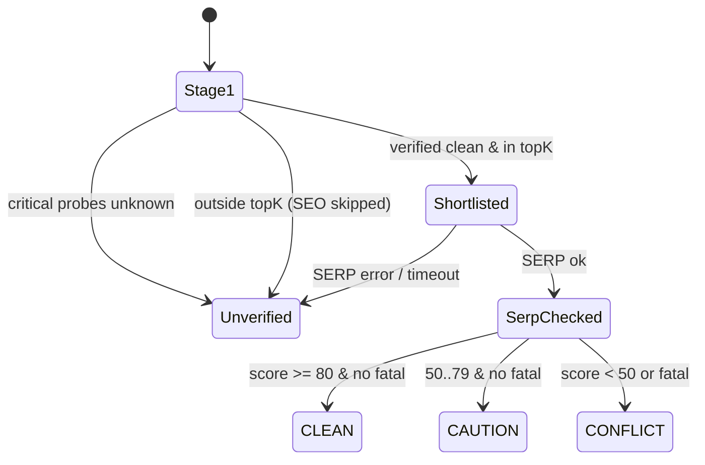
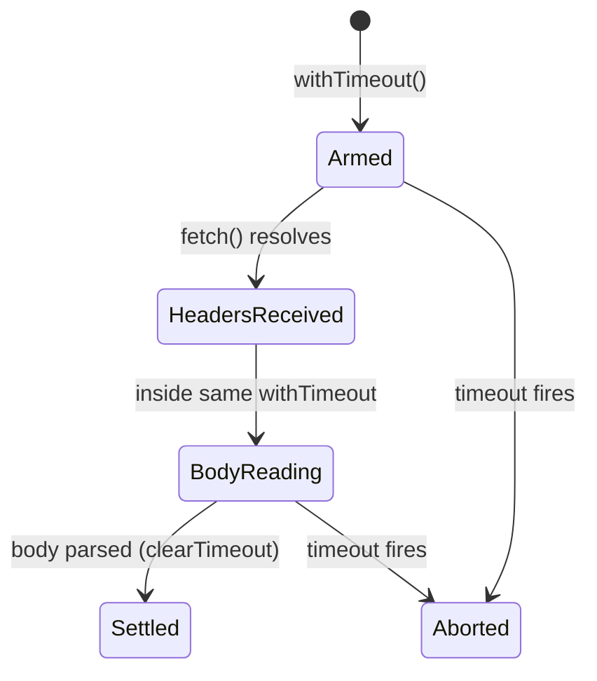

# Implicit State Machines — Audit

- **Date:** 2026-11-24
- **Scope:** `D:/Developer/brandlinter` (`src/**`, 23 TypeScript files across 4 non-overlapping slices)
- **Coverage:** 4/4 slices audited in parallel (`core`, `domain+ecosystem`, `serp+optional`, `cli+mcp`); 0 slices skipped
- **Findings:** 10 deduplicated root causes — P0: 3, P1: 5, P2: 2, P3: 0 (3 raw scout findings dropped as spec-correct or non-hazards)
- **Status:** verified (all 10 findings fixed; 67/67 tests passing)

## Definition

An implicit state machine is any combination of flags, refs, caches, timers, queues, or persisted keys whose legal value combinations and transitions exist only in the implementation, never in a type, enum, reducer, or state library.

## Decision Register

| ID | Question | Options | Chosen | Impact |
| :--- | :--- | :--- | :--- | :--- |
| D1 | How should `verdict` represent candidates whose SEO check was skipped (outside `topK`), errored, or whose Stage 1 probes returned `unknown`? | **A)** Add explicit `"UNVERIFIED"` verdict + rank verified-available above `unknown` when selecting `topK` *(recommended)* · **B)** Keep 3 verdicts (`CLEAN`/`CAUTION`/`CONFLICT`) and cap unverified/errored candidates at `CAUTION` (`<= 75`) | **A** | Eliminates false `CLEAN 100` verdicts on outages and un-searched tail candidates |
| D2 | Should `doctor` probe configured self-hosted endpoints (`OPENSERP_URL`, `SEARXNG_URL`)? | **A)** Report `resolvedSerpProvider` + config warnings + live reachability probe (default on in CLI `doctor`, opt-in/fast-timeout in MCP) *(recommended)* · **B)** Keep `doctor` 100% offline (only add `resolvedSerpProvider` + config warnings) | **A** | Prevents `doctor` from reporting `"ok"` on broken config or dead self-hosted SERP |
| D3 | Which GitHub repo matches should trigger the `-35` fatal popular-repo penalty? | **A)** Exact repo name match (`repo.name === slug`) OR org-owned repo (`owner === slug`) *(recommended)* · **B)** Org-owned repos only (`owner === slug`) | **A** | Eliminates false `CONFLICT` from unrelated substring matches while catching `author/anydisplay` |

## Findings

### ISM-01 — Unchecked or failed probes score as `CLEAN / 100`

- **Severity:** P0
- **Class:** ghost state (optimistic success)
- **Files:** `src/core/pipeline.ts:66-78,133-155`, `src/core/scorer.ts:38-97`, `src/providers/serp/*.ts`, `src/cli/formatters.ts:41-58`
- **Hidden state:** `(seoSkipped, serpError, serpConfidence, availabilityUnknownCount, score, verdict)`
- **Illegal transition:** `stage1 unknown OR serp failed (error set, results=[]) OR candidate outside topK (seo=undefined) -> scoreCandidate(serpResults=[]) -> verdict: "CLEAN", score: 100`
- **Blast radius:** During a SERP outage, rate limit, expired API key, or on candidates beyond `topK`, names with live competitors are certified `CLEAN / 100`, and all-`unknown` candidates sort to the top of `topK` pushing genuinely clean names out.
- **Decision:** D1 (pending)
- **Intended invariant after fix:** `CLEAN` is reachable only when Stage 1 critical probes are not `unknown` AND Stage 2 SERP succeeded without error; unverified/skipped/errored candidates cannot reach `CLEAN`.

### ISM-02 — `withTimeout` clears timer at headers; body reads run unguarded

- **Severity:** P0
- **Class:** orphaned async owner
- **Files:** `src/core/concurrency.ts:29-41` (declaration & `clearTimeout`), plus `src/providers/serp/*.ts`, `src/providers/domain/doh.ts:24`, `src/providers/ecosystem/github.ts:61`, `src/providers/ecosystem/npm.ts:15`, `src/providers/optional/{appstores,porkbun}.ts`
- **Hidden state:** `(timerArmed, headersReceived, bodyReadComplete, semaphoreSlotHeld)`
- **Illegal transition:** `headers arrive -> withTimeout finally clears timer -> res.json()/res.text() stalls -> Semaphore slot held forever -> batch deadlocks`
- **Blast radius:** A single slow/stalled response body hangs the entire CLI/MCP batch indefinitely with no timeout or exit.
- **Decision:** Unambiguous bugfix (no decision required)
- **Intended invariant after fix:** `AbortController` timer remains armed until both `fetch()` AND body consumption (`res.json()`/`res.text()`) settle.

### ISM-03 — Invalid SERP provider string silently falls through to `auto` / DuckDuckGo

- **Severity:** P0
- **Class:** ghost state / unvalidated enum
- **Files:** `src/core/config.ts:116-119`, `src/providers/serp/resolver.ts:15-52`, `src/cli/main.ts:84`
- **Hidden state:** `serpProvider: string` cast to `SerpProviderId` with no runtime validation and no `default:` branch in `switch`.
- **Illegal transition:** `--provider serperr` -> `chosen !== "auto"` -> switch matches nothing -> falls through to auto-detection -> silently calls another configured host or DuckDuckGo.
- **Blast radius:** User specifies a paid/self-hosted provider, makes a typo, and silently runs on a different provider or low-confidence scraper with exit code 0.
- **Decision:** Unambiguous bugfix (no decision required)
- **Intended invariant after fix:** Any `serpProvider` outside the valid enum throws immediately during config resolution and in `resolveSerpProvider`'s `default:` branch.

### ISM-04 — Exact and niche SERP results concatenated into one top-10 + single `error` field

- **Severity:** P1
- **Class:** duplicated truth / collapsed state
- **Files:** `src/core/pipeline.ts:100-111,147`, `src/core/scorer.ts:44,55`, `src/cli/formatters.ts:41`
- **Hidden state:** `(exactResults, exactError, nicheResults, nicheError)` flattened into `combinedSerp` + single `error?: string`.
- **Illegal transition:** `exact` returns 0–2 hits -> `concat(exact, niche)` pushes niche hits into `slice(0, 3)` (`dictionaryTrap`) and `slice(0, 10)` (`exactDomainInSerp`); or `exact` succeeds while `niche` fails -> `formatSeoMarkdown` hides `error` completely.
- **Blast radius:** False `CAUTION`/`CONFLICT` from cross-query rank mixing and invisible partial SERP failures.
- **Decision:** Unambiguous bugfix (no decision required)
- **Intended invariant after fix:** `exact` and `niche` keep independent `SerpQueryResult` states (`results`, `error`, `confidence`), and `scorer.ts` evaluates exact-domain / dictionary traps against `exactResults` and niche overlap separately.

### ISM-05 — `Semaphore.run` overshoots `maxConcurrency` across wake-up `await`

- **Severity:** P1
- **Class:** reentrancy across an await
- **Files:** `src/core/concurrency.ts:2-3,12-25`
- **Hidden state:** `(active, queue.length, wokenWaiterNotYetResumed)`
- **Illegal transition:** `active === max` -> releaser executes `active--` and wakes queued waiter -> synchronous new `run()` enters before microtask resumes, sees `active < max`, increments `active++` -> woken waiter resumes and increments `active++` -> `active === max + 1`.
- **Blast radius:** Exported `Semaphore` can exceed configured concurrency under interleaved async submissions, risking provider 429 storms.
- **Decision:** Unambiguous bugfix (no decision required)
- **Intended invariant after fix:** Permit ownership transfers directly from finishing task to the next queued waiter without decrementing `active` when `queue.length > 0`, guaranteeing `active <= maxConcurrency` at every microtask boundary.

### ISM-06 — DuckDuckGo bot-challenge 2xx pages & `/l/?uddg=` redirects produce ghost-clean results

- **Severity:** P1
- **Class:** ghost state
- **Files:** `src/providers/serp/duckduckgo.ts:9-13,29-47`
- **Hidden state:** `(httpOk, isChallengePage, hrefFormat, extractedDomain)`
- **Illegal transition:** (a) DDG returns HTTP 200/202 bot challenge -> 0 regex matches -> returns `{ results: [], error: undefined }` -> scored CLEAN. (b) DDG emits `/l/?uddg=https%3A%2F%2Fcompetitor.app` -> `new URL` throws -> `domain: ""` -> `exactDomainInSerp` never matches.
- **Blast radius:** Zero-config default SERP misses live competitors or reports every candidate clean when throttled.
- **Decision:** Unambiguous bugfix (no decision required)
- **Intended invariant after fix:** DDG adapter unwraps `uddg` target URLs, resolves relative hrefs, and detects challenge/anomaly HTML returning an explicit `error`.

### ISM-07 — `doctor` reports `status: "ok"` on corrupt config, half-configured keys, or dead endpoints

- **Severity:** P1
- **Class:** optimistic success
- **Files:** `src/core/config.ts:86-95,157-176`, `src/cli/main.ts:43-46`, `src/mcp/server.ts:91-99`
- **Hidden state:** `(configFileParseError, halfConfiguredProvider, endpointReachable)` collapsed into static `{ status: "ok" }`.
- **Illegal transition:** Malformed `brandlinter.config.json` OR `GOOGLE_CSE_API_KEY` set without `GOOGLE_CSE_CX` OR unreachable `OPENSERP_URL` -> `doctor` outputs `status: "ok"`.
- **Blast radius:** Agents/users trust `doctor` as a readiness gate and silently fall back to degraded providers.
- **Decision:** D2 (pending)
- **Intended invariant after fix:** `doctor` reports `resolvedSerpProvider`, surfaces config parse/half-config `warnings[]`, and reflects degraded/unhealthy status honestly.

### ISM-08 — GitHub `orgAvailable`/`topRepo` mismatch & uncorroborated `rdap.org` 404

- **Severity:** P1
- **Class:** split truth / uncorroborated status
- **Files:** `src/providers/ecosystem/github.ts:10-78`, `src/providers/domain/rdap.ts:31-73`, `src/core/scorer.ts:64-73`
- **Hidden state:** `(orgAvailable, topRepo.owner, topRepo.name)` in `github.ts`; `(rdapSource: direct|rdap.org, rdap404, dohNsExists)` in `rdap.ts`.
- **Illegal transition:** (a) Org `HEAD` fails (`unknown`) while search returns `slug/repo` -> `orgAvailable` never promoted to `taken`. (b) Substring repo `other/awesome-slug-helper (500★)` triggers fatal `-35 CONFLICT`. (c) `rdap.org` returns 404 for an unbootstrapped TLD without DoH corroboration.
- **Blast radius:** False `CONFLICT` on substring repos, missed `-15` org penalty on throttled HEAD, and potential false `available` on non-direct RDAP TLDs.
- **Decision:** D3 (pending for GitHub repo matching rule; DoH corroboration on non-direct `rdap.org` 404 and `orgAvailable` promotion are unambiguous fixes)
- **Intended invariant after fix:** `github.ts` promotes `orgAvailable` to `taken` if any returned repo is owned by `slug`, matches repo collisions per D3, and `rdap.ts` corroborates non-direct `rdap.org` 404 against DoH NS records.

### ISM-09 — CLI command dispatch & flag validation order diverges exit codes

- **Severity:** P2
- **Class:** unvalidated input / implicit dispatch order
- **Files:** `src/cli/main.ts:48-119`, `src/core/pipeline.ts:133`
- **Hidden state:** `(cmdValid, argsParsed, configResolved, topK, format)`
- **Illegal transition:** `brandlinter lintt` prints "provide at least one candidate" instead of "Unknown command"; `brandlinter check --help` exits 1 with Node `parseArgs` error; `--top-k -1` silently drops the last candidate via `slice(0, -1)`; unknown `--format` silently renders markdown.
- **Blast radius:** Broken scripting/CI exit codes and silent flag misinterpretation.
- **Decision:** Unambiguous bugfix (no decision required)
- **Intended invariant after fix:** Command validity and `--help` are checked before `parseArgs`/`resolveConfig`; `--top-k >= 1`, `--format`, `--registries`, and `--provider` are strictly validated with exit code 2 on usage error.

### ISM-10 — Latent authwall collapse in `social.ts` and substring `bundleId` match in `appstores.ts`

- **Severity:** P2
- **Class:** collapsed status
- **Files:** `src/providers/optional/social.ts:27-42`, `src/providers/optional/appstores.ts:33-46`
- **Hidden state:** `(finalUrlHostPath, status)` in `social.ts`; `(exactName, bundleIdSubstring)` in `appstores.ts`.
- **Illegal transition:** Social handle redirects to `/login` returning HTTP 200 -> marked `taken`; App Store `bundleId.includes("art")` matches `com.foo.smartboard` -> marked `taken`.
- **Blast radius:** None in current CLI/MCP (optional providers not yet wired into pipeline), latent false `taken` once wired.
- **Decision:** Unambiguous bugfix (no decision required)
- **Intended invariant after fix:** `social.ts` treats auth/login redirects as `unknown`; `appstores.ts` matches exact `trackName` or exact final `bundleId` segment.

---

## Coverage Notes

- **Slices scanned:** `src/core/*`, `src/providers/domain/*`, `src/providers/ecosystem/*`, `src/providers/serp/*`, `src/providers/optional/*`, `src/cli/*`, `src/mcp/*`, `src/index.ts`.
- **Dropped findings (verified non-hazards):**
  - PyPI `co--op` vs `co-op` aliasing (`ISM-SANITIZE-1`): PEP 503 specifies that runs of `[-_.]` are equivalent on PyPI, so reporting `taken` is accurate.
  - All-or-nothing batch slug validation (`ISM-MCP-3`): intentional security boundary per `SECURITY.md`.
  - Per-call `resolveConfig()` in MCP (`ISM-MCP-4`): intentional so `.env`/config edits apply without restarting MCP servers.
- **Deferred:** None.
