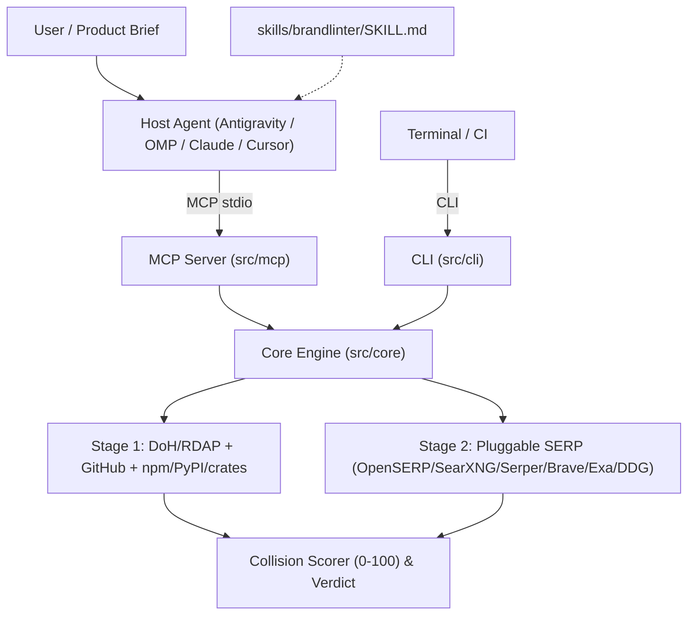

# brandlinter — Architecture & Spec

> **A pluggable, agent-native CLI and MCP server for linting product, startup, and open-source names against SEO collisions, domain registries, GitHub namespaces, and package ecosystems.**

> **Task Tracking:** Granular tasks, checklists, and live status live in [.kanban/](.kanban/). This file is the stable architecture & design reference.

---

## 1. Core Design Principles

1. **Brain in the Agent, Hands in the Tool:** `brandlinter` does not embed an LLM. The host agent (Antigravity, OMP, Claude, Cursor) brainstorms candidates via `skills/brandlinter/SKILL.md`; `brandlinter` runs deterministic parallel verification.
2. **Two-Stage Funnel:** Stage 1 (`lint_availability`) screens 15–30 candidates against fast/free sources (DoH, RDAP, GitHub, npm/PyPI/crates.io). Stage 2 (`lint_seo`) checks only the top 5–8 finalists against pluggable SERP providers.
3. **Zero-Config Default, BYOK & Self-Hosted Ready:** Works out of the box with zero keys, and upgrades seamlessly with **OpenSERP**, **SearXNG**, **Serper**, **Brave**, **Google CSE**, **Exa**, **Porkbun**, or `GITHUB_TOKEN`.
4. **Evidence Over False Positives:** Explicitly distinguishes `available`, `taken`, and `unknown` (rate-limit/timeout/unsupported TLD).
5. **Test-Driven Development (TDD):** Every module and provider is built **test-first** (Red -> Green -> Refactor) using Vitest with mocked HTTP fixtures.

---

## 2. System Architecture

---

## 3. Tech Stack & Directory Structure

- **Runtime:** TypeScript (Node.js >= 20 / Bun compatible), `@modelcontextprotocol/sdk`, `zod`, `tsup`, `vitest`.
- **Layout:** `src/core/` (`config.ts`, `sanitize.ts`, `concurrency.ts`, `scorer.ts`, `pipeline.ts`), `src/providers/` (`domain/`, `serp/`, `ecosystem/`, `optional/`), `src/cli/`, `src/mcp/`, `skills/brandlinter/SKILL.md`, `tests/`.
- **Security Invariants:** Strict slug validation (`^[a-z0-9][a-z0-9-]{0,61}[a-z0-9]?$`), no shell interpolation for untrusted input (`execFile` only for `gh`/`whois`), no secret leakage in output, `stdout` reserved for JSON-RPC in `mcp` mode.

---

## 4. Roadmap Summary

| Phase | Scope | Status | Card |
| :--- | :--- | :--- | :--- |
| **Phase 1** | Core Engine, Stage 1 Providers (DoH/RDAP, GitHub, npm/PyPI/crates) & CLI (`check`, `doctor`) | `done` | [20261124_121001_phase1_core_stage1_cli.md](.kanban/20261124_121001_phase1_core_stage1_cli.md) |
| **Phase 2** | Pluggable SERP Providers (`openserp`, `searxng`, `serper`, `brave`, `exa`, `ddg`) & Scorer (`seo`, `lint`) | `done` | [20261124_121002_phase2_serp_providers_scorer.md](.kanban/20261124_121002_phase2_serp_providers_scorer.md) |
| **Phase 3** | MCP Server (`stdio`), `SKILL.md`, & Opt-In Extensions (`porkbun`, `appstores`, `social`, `trademark`) | `done` | [20261124_121003_phase3_mcp_skill_extensions.md](.kanban/20261124_121003_phase3_mcp_skill_extensions.md) |
| **Phase 4** | `README.md`, GitHub Actions CI & npm Provenance Release | `done` | [20261124_121004_phase4_docs_oss_release.md](.kanban/20261124_121004_phase4_docs_oss_release.md) |
| **Phase 5** | v0.2.0: Real-World Ergonomics (`SKILL.md` gate, SERP failover, compact MCP, Exa keyword, App Store & near-miss) | `done` | [20261124_135001_phase5_v0_2_real_world_ergonomics.md](.kanban/20261124_135001_phase5_v0_2_real_world_ergonomics.md) |

---

## 5. v0.2.0 Behavioral Notes

- **Provider chain:** `resolveSerpProviderChain()` returns every configured provider in preference order plus DuckDuckGo, so `auto` mode can fail over. `searchWithFailover()` retries transient errors once, then advances, and keeps a batch-scoped cursor so later candidates never re-probe a dead provider. An explicit provider stays a single-entry chain.
- **SERP-only verdict:** `analyzeSerpResults()` and `summarizeSerpVerdict()` are the single source of truth for `exactDomainInSerp`, `nearDomainMatches`, `dictionaryTrap`, and `seoVerdict`; both `scoreCandidate()` and the compact MCP formatter read them, so CLI and MCP can never disagree.
- **Near-miss signals:** page-1 second-level labels that share a prefix/suffix with candidates of 5+ characters count as `nearDomainMatches` (-15, forces `CAUTION`); App Store titles within one edit or sharing the prefix count as `appStoreNearMatches` (-15). This catches `localscreenshare.com` for `localscreen` and `TapSpan` for `Tabspan`.
- **Compact MCP payloads:** `src/mcp/format.ts` projects results to status maps, verdicts, and top hits (5 exact / 3 niche); `verbose: true` returns the raw payload. This keeps a 10-name SEO batch near 3 KB instead of spilling to a log artifact.
- **Exa is keyword-only:** exact-name collision checks need pages that literally contain the token; Exa's neural mode returned semantic neighbours (Stack Overflow "tab-width" for `tabspan`).
- **RDAP direct routes:** `.dev`/`.app` go to Google Registry (`pubapi.registry.google`), which answers authoritatively without the `rdap.org` redirect and 403 hop. All RDAP calls send an explicit `User-Agent`.
